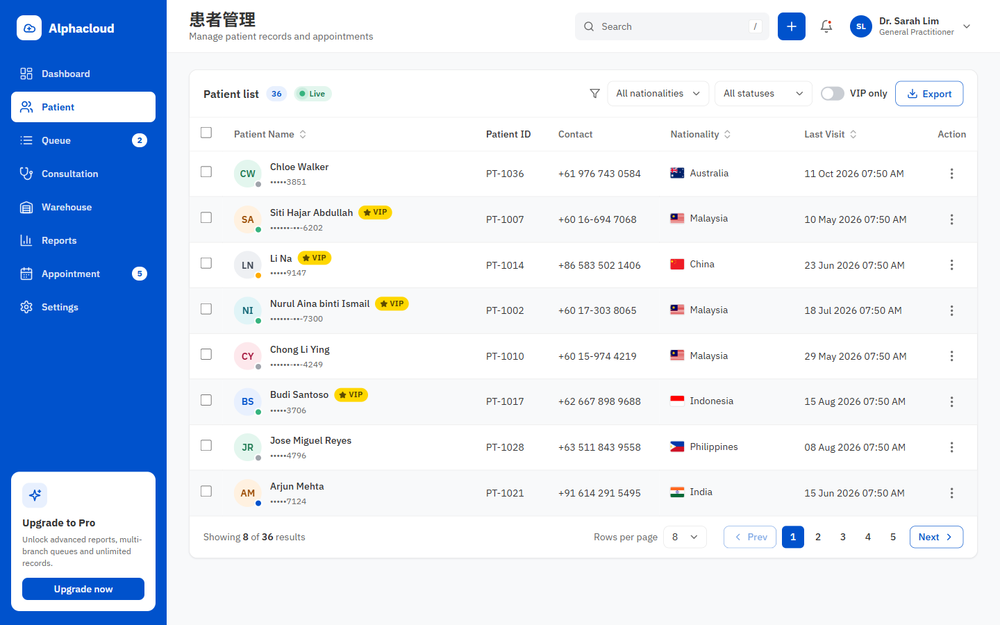
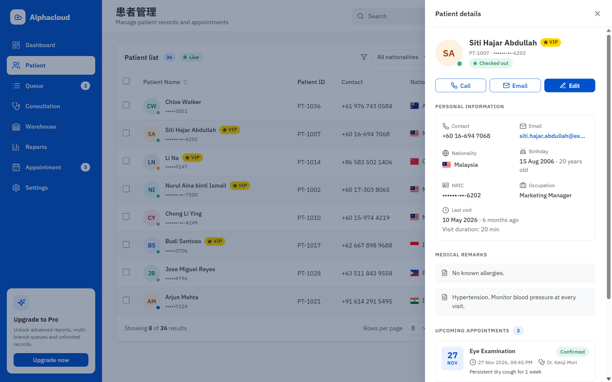

# Alphacloud · Patient Management UI

A responsive, accessible **Patient Management** front end (患者管理) built for the Alphacloud Frontend/UI assessment. It is plain HTML, CSS and vanilla JavaScript (native ES modules): **no framework, no build step and no runtime dependencies**. All data comes from an in-browser mock service, so there is no backend.



---

## Main functionality

- **Patient list:** avatar with a live status dot, name, masked NRIC/passport, Patient ID, contact number, nationality with flag, last visit (`DD MMM YYYY HH:MM AM/PM`), VIP badge and a row actions menu. Alternating `#F8F9FA` rows with hover and focus states.
- **Search** by name, Patient ID, phone (with or without spaces and hyphens), email or nationality. Identity numbers are deliberately not searchable.
- **Filters:** nationality, live status and VIP only. A pill shows the match count, such as `10 / 36`. Changing a filter returns to page 1.
- **Sorting** by Patient Name, Nationality and Last Visit through the column headers (`aria-sort` included). On mobile, a **Sort by** select replaces the headers and also offers registration order. The default order is newest registered first.
- **Pagination** with Prev/Next, page numbers, a rows-per-page selector (8, 16, 32) and "Showing X of Y results".
- **Detail panel** (slides in from the right): contact, email, nationality, birthday and age, masked NRIC/passport, occupation, last visit with how long ago and its duration, allergies (a separate structured list), medical remarks and upcoming appointment cards.
- **Add / edit patient** dialog with inline validation. Edits only change the fields in the form. The creation date, last visit, appointments and live status are kept.
- **VIP toggle** from the row menu or as a bulk action.
- **Delete with Undo.** The restored record goes back to its original position.
- **CSV export** of the filtered list, the current selection or a single record (see *Security and privacy*).
- **Bulk actions:** select rows to mark or unmark VIP, export or delete.
- **Simulated real-time status:** patients move through *Not in clinic → In queue → In consultation → Checked out*, updating the status dots and the sidebar Queue badge.
- **Loading, empty and error states**, including retry and error toasts for failed writes.



The sidebar items other than **Patient**, the notification bell, the profile menu and **Upgrade now** are placeholders. They show a short "not part of this demo" message.

## Technology stack

| Area | Choice |
| --- | --- |
| Markup and styles | HTML5, CSS custom properties (design tokens in `css/tokens.css`) |
| Scripts | Vanilla JavaScript ES modules, no bundler |
| Fonts | IBM Plex Sans; Noto Sans SC for the Chinese title, subset to its four glyphs (Google Fonts) |
| Flags | Images from [flagcdn.com](https://flagcdn.com) (emoji flags don't render on Windows) |
| Tests | Node's built-in test runner (`node:test`), with no packages to install |

## Requirements

- A current version of Chrome, Edge, Firefox or Safari. The app uses `<dialog>`, `inert`, `structuredClone` and `:focus-visible`.
- Any static file server. The examples below use Python 3 or Node.
- **Node.js 22 or newer** to run the tests (for glob support in `node --test`). They were run on Node 24.
- An internet connection for the web fonts and flag images. Without one, the app still works with system fonts, and the flags fall back to their alt text.

## Running locally

Serve the project folder over HTTP and open it in a browser:

```bash
# Python 3 (nothing to install)
python -m http.server 5173

# or Node (npx downloads the "serve" package the first time)
npx serve -l 5173 .
```

Then open <http://localhost:5173>. Laragon, VS Code Live Server or any other static server works too. No build step or environment variables are needed.

### Why `file://` doesn't work

Opening `index.html` directly from disk shows an empty shell. The app loads as an ES module (`<script type="module">`), and browsers treat every `file://` page as a unique, opaque origin, so they block its module imports under the CORS rules. Serving the folder over `http://localhost` avoids this.

### Demo URL flags

The mock service adds latency, so every UI state is real. These query parameters force specific states:

| URL | Effect |
| --- | --- |
| `/?delay=3000` | Simulated network latency in ms (default 550). Shows the loading skeletons. |
| `/?empty` | Starts with no patients and shows the empty state |
| `/?fail` | List and detail requests fail and show the error state with **Try again** |
| `/?failOps` | Writes (add, edit, delete, VIP) fail with an error toast or an inline form error |

## Running the tests

```bash
node --test "tests/*.test.mjs"
```

Keep the quotes: Node expands the glob itself, and recent versions reject a bare directory argument such as `node --test tests/`. On Node 18–20, list the files instead: `node --test tests/csv.test.mjs tests/identity.test.mjs`. No `package.json` is included because there is nothing to install. The tests use only `node:test` and `node:assert`.

To syntax-check every module:

```bash
for f in js/*.js js/*/*.js tests/*.mjs; do node --check "$f"; done
```

### Test coverage

There are 47 tests in two files:

- **`tests/csv.test.mjs`:** CSV formula-injection protection for every value starting with `=`, `+`, `-`, `@`, a tab or a carriage return, in every column including Contact. This includes international phone numbers such as `+44-20-7946-0958` and `+60 16-694 7068`. The file also covers RFC 4180 quoting (commas, quotes, multi-line remarks), empty and null values, masked identities in the full export, and the UTF-8 BOM.
- **`tests/identity.test.mjs`:** the NRIC/passport rules shared by the form and the service. Malaysia requires a 12-digit NRIC, and other nationalities require a 6–9 character passport. A nationality change requires a new document. A blank number with an unchanged nationality keeps the stored document. Edits preserve the creation date, last visit and appointments. Only the last four characters are ever stored.

The UI itself (components, focus management and responsive layout) has no automated tests in this repository. It was checked manually in a browser (see *Known limitations*).

## Security and privacy

- **Demo data is fictional.** Names, contact details and medical notes are generated from a fixed seed. Emails use the reserved `example.com` domain. No complete NRIC or passport number is ever generated: the seed produces only the last four characters.
- **Identity documents are never stored in full.** A typed number is validated, then reduced to its document type and last four characters before it reaches the data layer. The typed value is cleared from the form after saving or closing. Everywhere a number is displayed or exported, it is masked (`••••••-••-6202` or `•••••8977`), and screen readers hear "NRIC ending in 6 2 0 2".
- **Document integrity:** changing a patient's nationality requires a new document number, which must match the new nationality's document type. The form and the service enforce this independently.
- **CSV export** neutralises any value that a spreadsheet could run as a formula by prefixing it with an apostrophe. This applies to every column, with no exemptions for phone numbers. Fields are quoted per RFC 4180, and the file starts with a UTF-8 BOM so Excel reads names and Chinese text correctly. One side effect: phone numbers that start with `+` show a leading `'` in spreadsheet apps that display it literally.
- **Markup injection:** components render through an `html` tagged template that escapes every interpolated value.

## Accessibility

What was implemented and checked in Chromium:

- Keyboard operation throughout: a skip link, `/` to focus search, `↑`/`↓` between table rows, and the WAI-ARIA menu-button pattern for row and bulk menus.
- The detail panel and the add/edit dialog are modal. Focus is trapped (Tab and Shift+Tab wrap), Esc closes the topmost overlay, the background is `inert`, and focus returns to the control that opened the overlay. After an edit is saved from the panel, focus returns to the panel's **Edit** button.
- A visible focus indicator on every interactive element. Labels on all controls, with form errors linked through `aria-describedby` and `aria-invalid`.
- Text contrast meets WCAG AA (spec colours such as `#36B37E` and `#FFD700` are used as fills, with darker text on top). Flags have alt text, and decorative icons are hidden.
- `prefers-reduced-motion` and Windows forced-colours mode are respected.

These checks were automated DOM and contrast checks plus keyboard walkthroughs. **No screen reader (NVDA, JAWS or VoiceOver) testing has been done.**

## Responsive behaviour

| Width | Behaviour |
| --- | --- |
| ≥ 1200px | Full layout with the 240px sidebar |
| 768–1199px | A header toggle collapses the sidebar to a 72px icon rail (remembered). The table scrolls horizontally inside a focusable region when needed. |
| < 768px | Icon-only sidebar. Table rows become labelled cards, the column headers are replaced by a **Sort by** select, and pagination is condensed. The detail panel goes full width. |

Checked at 320, 375, 768, 1024, 1280 and 1440px with no page-level horizontal overflow.

## Project structure

```
index.html                     App shell and mount points
css/
  tokens.css                   Design tokens (colours, type, layout, z-index)
  base.css                     Reset, focus ring, buttons, badges, avatars, form controls
  layout.css                   Sidebar, header, main area
  components.css               Table, pagination, menu, drawer, dialog, toasts, tooltip, states
  responsive.css               Breakpoints, reduced motion, forced colours
js/
  main.js                      App state, data loading (with a race guard) and wiring
  components/                  sidebar, header, toolbar, patientTable, pagination, detailPanel,
                               actionMenu, patientDialog, toast, tooltip, icons
  services/patientService.js   Mock async API: list/get/create/update/remove/restore + live feed
  data/patients.js             Seeded, deterministic, fictional patients
  utils/                       dom.js (escaping html`` templates), format.js, csv.js
tests/                         node:test suites (CSV export, identity rules)
docs/                          README screenshots
```

Each component renders into a mount point and returns a small API, such as `update(state)`, `open()` or `setStatus()`. `main.js` owns the single state object and passes data down, while components report user actions through callbacks.

## Known limitations

- **No backend or persistence.** All data lives in memory and resets on reload. The service imitates latency and failures, but there is no real API, authentication or authorisation.
- **No automated UI tests.** Browser behaviour (focus management, overlays, responsive layout) was verified manually and with ad hoc browser scripts. Those scripts are not part of the repository.
- **Screen readers are untested** (see *Accessibility*).
- **Real-time updates are simulated** with a timer, not a WebSocket.
- **Desktop sorting:** once a column header has been clicked, the default "newest registered" order can only be restored by reloading (or with the mobile Sort by select). There is no Registered column to sort by.
- **External assets:** fonts and flag images load from Google Fonts and flagcdn.com.
- **CSV apostrophe:** formula-protected values, including `+` phone numbers, keep a visible leading `'` in some spreadsheet apps. This is the deliberate cost of not exempting any column from formula protection.
- Only the Patient module is implemented. The other navigation items are placeholders.
